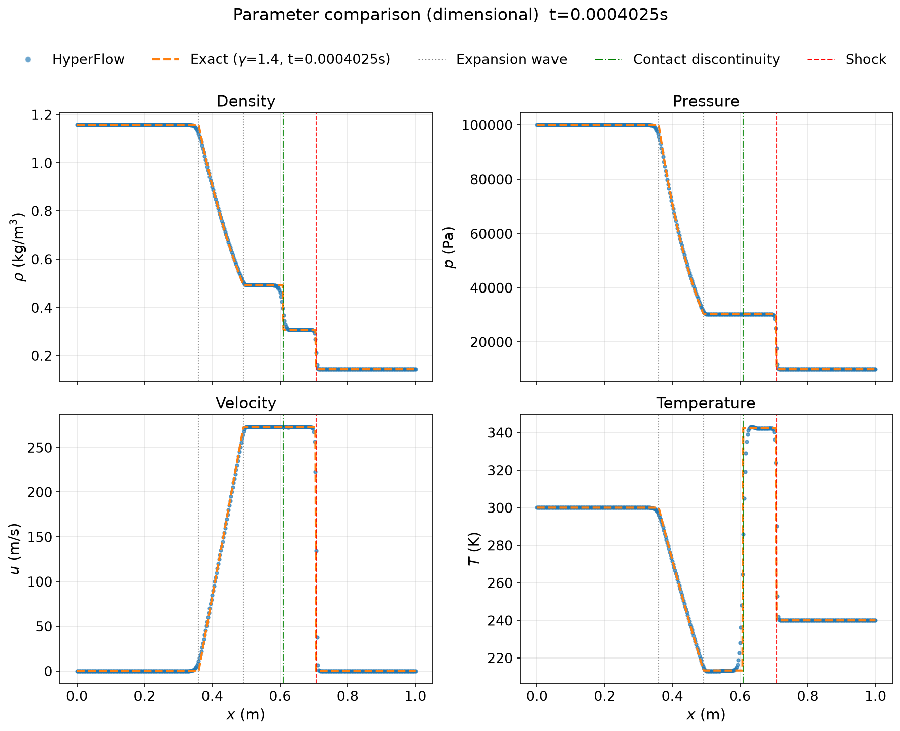

# HyperFlow — Technical Notes (1-D Unsteady)

Variable-area one-dimensional compressible duct flow with optional finite-rate chemistry. Cross-sectional area $A(x)$ and the initial field are supplied externally. There is no mass injection, mixing model, or wall friction.

# 1. Governing equations

## 1.1 Overview

Conservation form of the variable-area Euler equations with multiple species:

$$
\frac{\partial(\rho A)}{\partial t} + \frac{\partial(\rho u A)}{\partial x} = 0
$$

$$
\frac{\partial(\rho u A)}{\partial t} + \frac{\partial\bigl[(\rho u^2 + p)A\bigr]}{\partial x}
= pA\frac{\mathrm{d}\ln A}{\mathrm{d}x}
$$

$$
\frac{\partial(\rho A e_t)}{\partial t} + \frac{\partial\bigl[(\rho A e_t + pA)u\bigr]}{\partial x}
= 0
$$

$$
\frac{\partial(\rho A Y_k)}{\partial t} + \frac{\partial(\rho u A Y_k)}{\partial x}
= A\omega_k
$$

or, compactly,

$$
\frac{\partial \mathbf{U}}{\partial t} + \frac{\partial \mathbf{F}}{\partial x} = \mathbf{S}
$$

with

$$
\mathbf{U} =
\begin{bmatrix}
\rho A \\
\rho u A \\
\rho A e_t \\
\rho A Y_k \\
\vdots
\end{bmatrix},
\quad
\mathbf{F} =
\begin{bmatrix}
\rho u A \\
(\rho u^2 + p)\,A \\
(\rho A e_t + pA)\,u \\
\rho u A Y_k \\
\vdots
\end{bmatrix},
\quad
\mathbf{S} =
\begin{bmatrix}
0 \\[4pt]
pA\dfrac{\mathrm{d}\ln A}{\mathrm{d}x} \\[8pt]
0 \\[4pt]
A\omega_k \\
\vdots
\end{bmatrix}.
$$

In the flow substep the code assembles only the geometric source $pA\,\mathrm{d}\ln A/\mathrm{d}x$. The chemical source $A\omega_k$ is treated in the operator-split chemistry substep (constant-volume reactors; §2) and is not added to the flow source matrix.

**Symbols (SI):**

| Symbol | Meaning | Unit |
| --- | --- | --- |
| $A(x)$ | Cross-sectional area (prescribed) | $\mathrm{m^2}$ |
| $\rho,u,p,e_t$ | Density, axial velocity, pressure, specific total energy | $\mathrm{kg\,m^{-3}}$, $\mathrm{m\,s^{-1}}$, $\mathrm{Pa}$, $\mathrm{J\,kg^{-1}}$ |
| $Y_k$ | Mass fraction of species $k$ | — |
| $\omega_k$ | Mass production rate of species $k$ | $\mathrm{kg\,m^{-3}s^{-1}}$ |

$$
\frac{\mathrm{d}\ln A}{\mathrm{d}x} = \frac{1}{A}\frac{\mathrm{d}A}{\mathrm{d}x},
$$

obtained by differentiating the discrete $A(x_i)$. For a constant-area duct, $\mathrm{d}A/\mathrm{d}x=0$ and the geometric source vanishes.

## 1.2 Area and initial data

The solver does not generate duct geometry. A case supplies `initial.h5` with:

- face coordinates $x_i$ (length $n_{\mathrm{face}}$)
- areas $A_i$
- conserved field $\mathbf{U}$ ($n_{\mathrm{Var}}\times n_{\mathrm{face}}$)

The code forms $\mathrm{d}A/\mathrm{d}x$ and $\mathrm{d}\ln A/\mathrm{d}x$, then advances with the time step and boundary data in `config.json`.

# 2. Numerical method

## 2.1 Operator splitting

When `chemistry: true`, each step $\Delta t$ uses second-order **Strang** splitting:

$$
\text{flow (flux + area source):}\ \tfrac{\Delta t}{2}
\;\longrightarrow\;
\text{chemistry:}\ \Delta t
\;\longrightarrow\;
\text{flow (flux + area source):}\ \tfrac{\Delta t}{2}
$$

i.e.

$$
U^{(n+1)} = C^{(\Delta t/2)} S^{(\Delta t)} C^{(\Delta t/2)}\bigl(U^{(n)}\bigr).
$$

- **C**: convection + geometric source $pA\,\mathrm{d}\ln A/\mathrm{d}x$ (Heun)
- **S**: independent constant-volume IdealGasReactor at each face (Cantera / CVODE)

When `chemistry: false`, the chemistry substep is skipped and only $C^{(\Delta t)}$ is applied.

Splitting stiff chemistry from the flow avoids a fully coupled implicit system with a chemical Jacobian.

## 2.2 Flow discretization

### Spatial reconstruction: NND

Conserved variables $\mathbf{U}_j$ are stored at $x_j$. Left/right interface states use the **minmod** limiter (NND), biasing toward upstream information on the positive-flux side and downstream on the negative-flux side.

Left state at $x_{j+1/2}$ (positive flux):

$$
\mathbf{U}_{j+1/2}^L
= \mathbf{U}_{j}
+ \frac{1}{2}\,\mathrm{minmod}\bigl(\mathbf{U}_{j+1} - \mathbf{U}_{j},\,\mathbf{U}_{j} - \mathbf{U}_{j-1}\bigr)
$$

Right state at $x_{j-1/2}$ (negative flux):

$$
\mathbf{U}_{j-1/2}^R
= \mathbf{U}_{j}
+ \frac{1}{2}\,\mathrm{minmod}\bigl(\mathbf{U}_{j-1} - \mathbf{U}_{j},\,\mathbf{U}_{j} - \mathbf{U}_{j+1}\bigr)
$$

Right state at $x_{j+1/2}$ (negative flux):

$$
\mathbf{U}_{j+1/2}^R
= \mathbf{U}_{j+1}
+ \frac{1}{2}\,\mathrm{minmod}\bigl(\mathbf{U}_{j} - \mathbf{U}_{j+1},\,\mathbf{U}_{j+1} - \mathbf{U}_{j+2}\bigr)
$$

#### minmod

$$
\mathrm{minmod}(a,b) =
\begin{cases}
0, & ab \leqslant 0 \\[4pt]
(\operatorname{sgn} a)\,\min(|a|,|b|), & ab > 0
\end{cases}
$$

### HLLC flux

The numerical flux follows Toro’s HLLC. Relative to the constant-area Euler system, the present equations include area $A$; conservation is preserved by replacing $\rho\to\rho A$ and $p\to pA$ in the HLLC formulae.

#### HLLC with cross-sectional area $A$

Consider the **source-free** variable-area Euler system:

$$
\frac{\partial(\rho A)}{\partial t} + \frac{\partial(\rho u A)}{\partial x} = 0
$$

$$
\frac{\partial(\rho u A)}{\partial t} + \frac{\partial\bigl[(\rho u^2 + p)A\bigr]}{\partial x} = 0
$$

$$
\frac{\partial(\rho A e_t)}{\partial t} + \frac{\partial\bigl[(\rho A e_t + pA)u\bigr]}{\partial x} = 0
$$

with

$$
\mathbf{U} =
\begin{bmatrix}
\rho A \\ \rho u A \\ \rho A e_t
\end{bmatrix},
\qquad
\mathbf{F} =
\begin{bmatrix}
\rho u A \\ (\rho u^2 + p)A \\ u(\rho A e_t + pA)
\end{bmatrix}.
$$

Rankine–Hugoniot relations across the left wave $S_L$ give

$$
S_L\,\rho_{*L}A_{*L} - \rho_{*L}u_{*L}A_{*L} = S_L\,\rho_LA_L - \rho_Lu_LA_L,
$$

$$
S_L\,\rho_{*L}u_{*L}A_{*L} - \bigl(\rho_{*L}u_{*L}^2 + p_{*L}\bigr)A_{*L}
= S_L\,\rho_Lu_LA_L - \bigl(\rho_Lu_L^2 + p_L\bigr)A_L,
$$

$$
S_L\,E_{*L}A_{*L} - u_{*L}\bigl(E_{*L} + p_{*L}\bigr)A_{*L}
= S_L\,E_LA_L - u_L\bigl(E_L + p_L\bigr)A_L,
$$

where $E=\rho e_t$ is the total energy density, so $EA=\rho A e_t$ matches the third component of $\mathbf{U}$.

From the first two equations,

$$
p_{*L}A_{*L} = \Bigl[\rho_L(S_L - u_L)(u_{*L} - u_L) + p_L\Bigr]A_L,
$$

and similarly on the right,

$$
p_{*R}A_{*R} = \Bigl[\rho_R(S_R - u_R)(u_{*R} - u_R) + p_R\Bigr]A_R.
$$

**Contact conditions** (unlike the constant-area case, $p$ itself need not be continuous — $pA$ is continuous):

$$
p_{*L}A_{*L} = p_{*R}A_{*R}, \qquad u_{*L} = u_{*R} = S_*.
$$

The star-region speed is

$$
S_* =
\frac{p_RA_R - p_LA_L + \rho_LA_Lu_L(S_L - u_L) - \rho_RA_Ru_R(S_R - u_R)}
{\rho_LA_L(S_L - u_L) - \rho_RA_R(S_R - u_R)}.
$$

The left star state is

$$
\mathbf{U}_{*L} =
\begin{bmatrix}
\displaystyle \rho_LA_L\,\frac{S_L - u_L}{S_L - S_*} \\[8pt]
\displaystyle \rho_LA_L\,\frac{S_L - u_L}{S_L - S_*}\,S_* \\[8pt]
\displaystyle \rho_LA_L\,\frac{S_L - u_L}{S_L - S_*}\,
\Biggl[\frac{E_L}{\rho_L} + (S_* - u_L)\Bigl(S_* + \frac{p_L}{\rho_L(S_L - u_L)}\Bigr)\Biggr]
\end{bmatrix}.
$$

$\mathbf{U}_{*R}$ follows by $L\to R$, $S_L\to S_R$. Star fluxes satisfy

$$
\mathbf{F}_{*L} = \mathbf{F}_L + S_L\bigl(\mathbf{U}_{*L} - \mathbf{U}_L\bigr), \qquad
\mathbf{F}_{*R} = \mathbf{F}_R + S_R\bigl(\mathbf{U}_{*R} - \mathbf{U}_R\bigr).
$$

The interface flux $\mathbf{F}_{j+1/2}$ is selected among $\mathbf{F}_L$, $\mathbf{F}_{*L}$, $\mathbf{F}_{*R}$, $\mathbf{F}_R$ by the usual $(S_L,S_*,S_R)$ branching.

**Summary:** variable-area HLLC uses area-weighted quantities ($\rho A$, $pA$) in the Rankine–Hugoniot and contact conditions; substituting $\rho\to\rho A$ and $p\to pA$ (with left/right cell areas at the interface) recovers a consistent discrete flux.

## 2.3 Chemistry

Chemistry uses a Cantera detailed mechanism and CVODE (IdealGasReactor / ReactorNet). In the chemistry substep each face is an independent **constant-volume** 0-D reactor: initialize with local $\rho$, $e$, $Y_k$, advance by $\Delta t$, then write back $\rho A Y_k$.

There is no mixing relaxation; the full local composition reacts. If `chemistry: false`, this substep is skipped.

# 3. Verification

## 3.1 Dimensional Sod shock tube

The classical **Sod** problem checks NND reconstruction, HLLC flux, Heun time integration, and Riemann-type boundaries. The duct is constant-area with chemistry off, compared to the exact $\gamma=1.4$ ideal-gas Riemann solution.

### Setup

| Quantity | Value |
| --- | --- |
| Length | $L=1\,\mathrm{m}$, diaphragm $x_{\mathrm{m}}=0.5\,\mathrm{m}$ |
| Left ($x<x_{\mathrm{m}}$) | $p_L=10^5\,\mathrm{Pa}$, $T_L=300\,\mathrm{K}$, $u_L=0$, $\rho_L\approx 1.1567\,\mathrm{kg\,m^{-3}}$ |
| Right ($x>x_{\mathrm{m}}$) | $p_R=10^4\,\mathrm{Pa}$, $T_R=240\,\mathrm{K}$, $u_R=0$, $\rho_R\approx 0.1446\,\mathrm{kg\,m^{-3}}$ |
| Pressure / density ratios | $p_R/p_L=0.1$, $\rho_R/\rho_L=0.125$ (classical Sod) |
| Area | $A\equiv 1$ |
| Mesh | $n_{\mathrm{cell}}=400$ ($n_{\mathrm{face}}=401$, $\Delta x=2.5\,\mathrm{mm}$) |
| Time | $t_{\mathrm{final}}=4.025\times 10^{-4}\,\mathrm{s}$, $\Delta t=5\times 10^{-8}\,\mathrm{s}$ |
| Gas | Air (`O2:1, N2:3.76`); exact solution uses $\gamma=1.4$ |

Left/right states are closed with Cantera from $(T,p,Y)$; the exact solution uses the same IC with fixed $\gamma=1.4$.

### Exact wave pattern ($t=t_{\mathrm{final}}$)

Left-going rarefaction + contact + right-going shock (relative to $x_{\mathrm{m}}$):

| Quantity | Exact |
| --- | --- |
| $p_*$ | $\approx 3.031\times 10^4\,\mathrm{Pa}$ |
| $u_*$ | $\approx 272.7\,\mathrm{m\,s^{-1}}$ |
| $\rho_{*L}$ (left of contact) | $\approx 0.493\,\mathrm{kg\,m^{-3}}$ |
| $\rho_{*R}$ (right of contact) | $\approx 0.307\,\mathrm{kg\,m^{-3}}$ |
| Rarefaction head / tail | $x\approx 0.360\,\mathrm{m}$ / $0.492\,\mathrm{m}$ |
| Contact | $x\approx 0.610\,\mathrm{m}$ |
| Shock | $x\approx 0.707\,\mathrm{m}$ |

### Comparison

HyperFlow (blue markers) vs exact (orange dashed) for $\rho$, $p$, $u$, $T$; vertical lines mark rarefaction head/tail, contact, and shock.

**Findings:**

1. **Wave structure:** rarefaction, contact, and shock locations match the exact solution; across the contact only density and temperature jump, while pressure and velocity remain continuous.
2. **Plateaus:** undisturbed end states and star-region plateaus ($p_*$, $u_*$, both $\rho_*$) agree well.
3. **Capturing:** shock and contact are resolved over a few cells with the usual NND/HLLC smearing and without large oscillations.
4. **Temperature:** contact-side temperatures match the exact solution, supporting thermodynamic closure (Cantera vs $\gamma=1.4$) with chemistry off.

This verifies the **flow substep + Riemann boundaries** for discontinuous 1-D flow. Results recomputed with the present `HyperFlow`: `examples/sod_shock/sod_final.csv` and `examples/sod_shock/sod_compare_params.png`.
