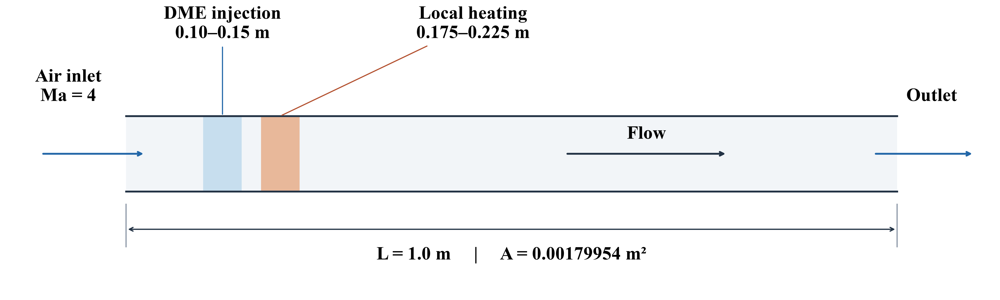
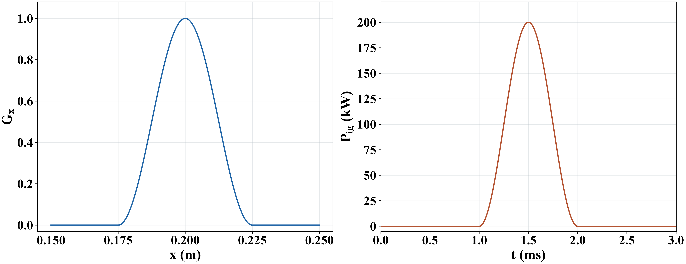
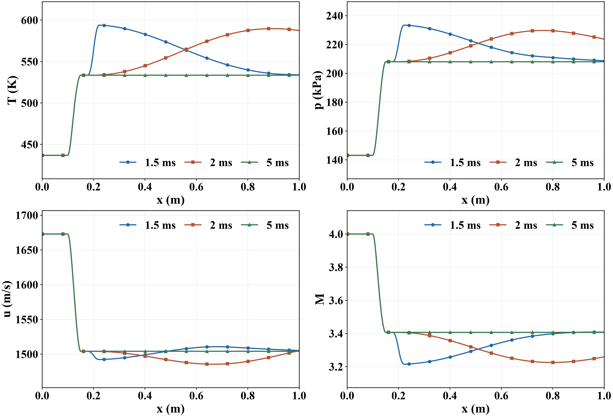

# HyperFlow V2

HyperFlow solves quasi-one-dimensional reacting flow in variable-area ducts using finite volumes, NND/HLLC fluxes, Cantera thermochemistry and coupled implicit integration.

## DME heat-source example

A 1 m constant-area duct with DME injection and a 100 J heat pulse, initialized from a steady flow. Air inlet: Ma = 4, 436.8 K, 143.119 kPa and 3.422785 kg/s. DME injection: 300 K, 300 m/s and equivalence ratio 1.0; fully mixed, with wall friction off.

*Duct layout and source locations; transverse dimensions are schematic.*

*Heat input: 0.175–0.225 m, active from 1 to 2 ms; peak power 200 kW.*

*Temperature, pressure, velocity and Mach number at 1.5, 2 and 5 ms (500 cells, 39-species DME). The thermal disturbance travels downstream; no shock is resolved over 0–5 ms. Minimum saved Ma: 3.21; peak temperature: 594.03 K.*

## Changes from V1

- Coupled implicit integration replaces explicit time stepping and split chemistry.
- Cell-centered, area-consistent finite-volume formulation.
- Fuel injection, mixing-controlled chemistry and wall friction.
- Local heat input with prescribed energy, location, width and duration.
- Consistent total-mass and species balances.
