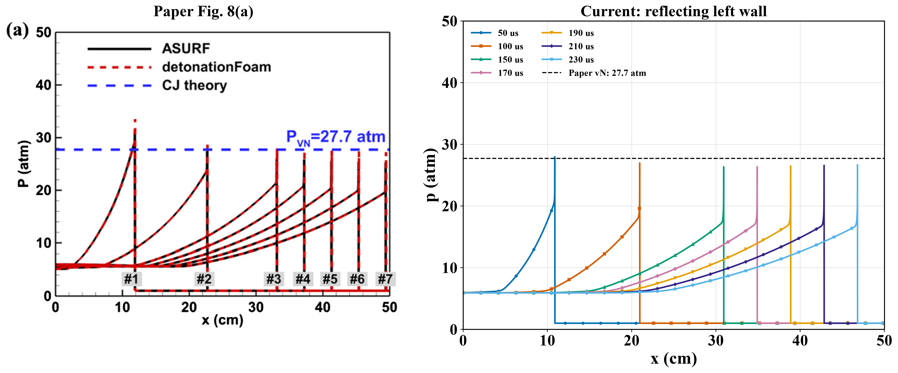
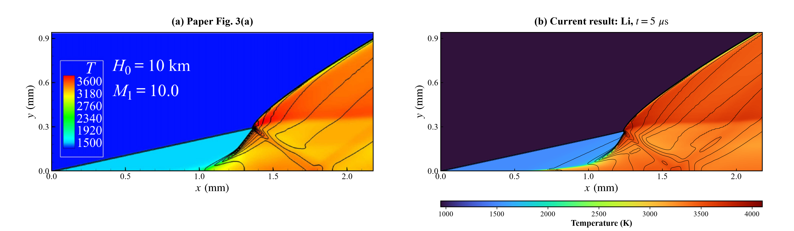

# HyperFlow V3

HyperFlow V3 is a finite-volume solver for two-dimensional compressible reacting flows, based on the inviscid multicomponent Euler equations with finite-rate chemistry. It combines shock-capturing convection, stiff chemical integration and local adaptive mesh refinement for coupled flow–chemistry calculations.

## Governing equations

The conservative system is

$$
\frac{\partial \mathbf{U}}{\partial t}
+\frac{\partial \mathbf{F}}{\partial x}
+\frac{\partial \mathbf{G}}{\partial y}
=\mathbf{S}_{\mathrm{chem}},
$$

with components ordered as mass, momentum, total energy and species:

$$
\mathbf{U}=
\begin{bmatrix}
\rho \\
\rho u \\
\rho v \\
\rho E \\
\rho Y_1 \\
\vdots \\
\rho Y_{N_s}
\end{bmatrix},
\qquad
\mathbf{F}=
\begin{bmatrix}
\rho u \\
\rho u^2+p \\
\rho uv \\
u(\rho E+p) \\
\rho uY_1 \\
\vdots \\
\rho uY_{N_s}
\end{bmatrix},
$$

$$
\mathbf{G}=
\begin{bmatrix}
\rho v \\
\rho uv \\
\rho v^2+p \\
v(\rho E+p) \\
\rho vY_1 \\
\vdots \\
\rho vY_{N_s}
\end{bmatrix},
\qquad
\mathbf{S}_{\mathrm{chem}}=
\begin{bmatrix}
0 \\
0 \\
0 \\
0 \\
W_1\dot{\omega}_1 \\
\vdots \\
W_{N_s}\dot{\omega}_{N_s}
\end{bmatrix}.
$$

Here, $\rho$ is mixture density, $(u,v)$ is velocity, $p$ is pressure, $Y_k$ is species mass fraction, $W_k$ is molecular weight and $\dot{\omega}_k$ is net molar production rate. The thermodynamic closure is

$$
E=e(T,\mathbf{Y})+\frac{u^2+v^2}{2},
\qquad
e(T,\mathbf{Y})=\sum_{k=1}^{N_s}Y_ke_k(T),
\qquad
p=\rho R_uT\sum_{k=1}^{N_s}\frac{Y_k}{W_k}.
$$

Species densities satisfy $\rho=\sum_k\rho Y_k$ and $\sum_kY_k=1$. The species internal energies include formation energy, so chemical energy conversion is represented through composition and temperature without an additional source in the total-energy equation.

During the local chemical substep, density and specific internal energy remain fixed, and each active cell advances

$$
\frac{\mathrm{d}Y_k}{\mathrm{d}t}
=\frac{W_k\dot{\omega}_k(T,\rho,\mathbf{Y})}{\rho},
\qquad
\frac{\mathrm{d}\rho}{\mathrm{d}t}=0,
\qquad
\frac{\mathrm{d}e}{\mathrm{d}t}=0.
$$

Temperature is recovered from the thermodynamic closure as composition evolves.

## Numerical method

- **Convection:** NND/minmod reconstruction, HLLC numerical fluxes and explicit Heun time integration.
- **Chemistry:** the Li hydrogen mechanism with 9 species and 21 reactions. CVODE/BDF advances an independent constant-volume, adiabatic chemical ODE in each active cell; Cantera provides thermodynamic properties and reaction rates.
- **Coupling:** second-order Strang splitting, with a flow half-step, a chemistry full-step and a flow half-step. Total thermochemical energy includes formation energy, and nitrogen closes the species mass balance.
- **Mesh:** two-dimensional block-structured AMR using AMReX, with conservative interpolation, reflux and synchronized time stepping. Both cases use the same solver and are selected through their input configurations.

## Validation examples

### Planar CJ detonation

A high-temperature, high-pressure hot spot initiates detonation in an initially stationary stoichiometric hydrogen–air mixture at 300 K and 1 atm. The comparison shows pressure profiles at 50, 100, 150, 170, 190, 210 and 230 microseconds.

**Reference:** Sun, J., Wang, Y., Tian, B. & Chen, Z. (2023). *detonationFoam: An open-source solver for simulation of gaseous detonation based on OpenFOAM*. Computer Physics Communications, 292, 108859. Section 3.5, Fig. 8(a). [https://doi.org/10.1016/j.cpc.2023.108859](https://doi.org/10.1016/j.cpc.2023.108859).

### Wedge-induced oblique detonation

Temperature fields with pressure contours are compared for the Case 1 inflow and 19-degree wedge geometry of Teng et al.

**Reference:** Teng et al. (2021). *Morphology of oblique detonation waves in a stoichiometric hydrogen–air mixture*. Journal of Fluid Mechanics, 913, A1. Case 1, Fig. 3(a). [https://doi.org/10.1017/jfm.2020.1131](https://doi.org/10.1017/jfm.2020.1131).

[V1](../HyperFlow_V1/) · [V2](../HyperFlow_V2/)
